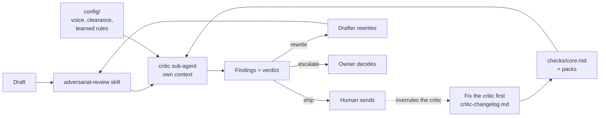

# the-critic

**Nothing AI-written leaves until a reviewer whose only job is to find why it will fail has read it.**


## The story

Every time I show a room how I work with AI, the same fear comes up, usually
from the most senior person there: "what stops it confidently sending rubbish
with my name on it?" They are right to ask. A model that drafts well will also
write a cold email that names a client who never agreed to be named, quotes a
result nobody can source, and asks a stranger for an hour of his leadership
team's time. It reads well. Sent, it costs you the client and the prospect at
once.

Now nothing leaves without a critic. It runs in its own context, it cannot see
how the draft was argued into existence, and its one instruction is: *your job
is NOT to be nice.* When I overrule it, I fix the critic before I fix the
draft. That last rule is what makes it get better instead of getting ignored.

The guide chapter for this repo:
[The critic](https://itstauf.com/resources/second-brain/critic?utm_source=github&utm_medium=readme&utm_campaign=compounding-brain&utm_content=the-critic).

## 60-second quickstart

**Claude Code**

```bash
git clone https://github.com/itstauf/the-critic
cp -r the-critic/.claude the-critic/checks the-critic/config the-critic/critic-changelog.md your-project/
```

Then, in your project:

```
> run the critic on drafts/email/intro.md
```

The `adversarial-review` skill spawns the `critic` sub-agent, which returns
findings like this and a verdict:

```
- [line 7 | clearance] "We recently helped Larch Atelier cut onboarding time by 40%..." : HARD FAIL. Larch Atelier is Anonymised in the registry and is named here : remove the name
verdict: rewrite
```

Fill `config/voice.md` and `config/clearance-registry.md` before you rely on
it. An empty config catches nothing.

## How it works



1. **A different reader.** The critic gets the draft and the rule files, and
   nothing else. It cannot see the drafting conversation, so it cannot inherit
   the drafter's excuses.
2. **Short, testable checks.** Six core checks run on everything: unsourced
   claims, generic messaging, contradicting a rule you already learned, honest
   classification (a guess called a fact, a draft called a decision), missing
   evidence for numbers, quotes and names, and audience mismatch. Packs add
   voice, client clearance, confidentiality walls, report style and decision
   memo checks.
3. **One line per finding.** `- [line N | category] "quoted line" : what's wrong : fix`.
   Exact quotes, so nobody argues about what was meant.
4. **Three verdicts.** `ship`, `rewrite`, or `escalate` to the human owner.
5. **It reports. It never fixes.** The drafter rewrites; the critic runs again
   in a fresh context.
6. **When the critic misses, fix the critic, not the output.** Every override
   becomes a change to the checks, logged in `critic-changelog.md`, before
   the draft is touched.

The markdown knowledge base under all of this is a common pattern, and I
credit it to Andrej Karpathy's LLM wiki. What these repos add is the part
nobody else ships: how the system decides what is true, how it polices its own
output, and how it grows its own tools. This repo is the policing.

### What is in the box

| Path | What it is |
|---|---|
| `.claude/agents/critic.md` | The critic as a Claude Code sub-agent, with its own context |
| `.claude/skills/adversarial-review/SKILL.md` | The skill that runs it, with an inline fallback |
| `checks/core.md` | Six universal checks and the "which packs run" table |
| `checks/packs/` | voice, clearance, confidentiality-walls, report-style, decision-memo |
| `config/` | Templates you fill: voice, clearance registry, learned rules |
| `critic-changelog.md` | How the critic learns, with one synthetic entry |
| `docs/` | Why adversarial, how to tune it, the optional slop scrub |
| `examples/` | A weak cold email, the full review, the rewrite, the second pass |
| `prompts/project-instructions.md` | Paste-in version for chat tools |

## Use it your way

### Claude Code

Copy `.claude/`, `checks/`, `config/` and `critic-changelog.md` into your
project. Say "run the critic on <file>". The sub-agent runs in its own context
window. That is the strongest version of this repo.

### Claude.ai Projects or ChatGPT Projects

Paste `prompts/project-instructions.md` into the project instructions. Upload
`checks/core.md`, the packs you want, and your filled `config/` files as
knowledge. Say "run the critic" after a draft. This runs in the same context
as the drafting, so for a cleaner read start a new chat with only the draft.

### Cursor, Codex, or any agent that reads AGENTS.md

`AGENTS.md` points the agent at the same critic instruction, checks and
configs. If your tool can open a fresh agent or context, use it for the critic.

### No agent

Read `checks/core.md` as a checklist and `examples/` as a worked case. The
method works on paper: write the draft, put it away, come back as someone whose
job is to sink it, and write one quoted line per problem.

### Running it with a team

- **Who may edit what.** Anyone can run the critic. Only the owner of the
  standards edits `checks/` and `config/`. Only the person who can actually
  get a client's permission edits `config/clearance-registry.md`.
- **CODEOWNERS.** Put `checks/`, `config/` and `.claude/agents/critic.md`
  under one owner so changes to the gate need their review.
- **Review gate.** Make a passing critic review (or a recorded `escalate`
  decision) a condition for anything that leaves the team. A `ship` verdict
  still needs a human to press send.
- **Overrides are data.** When a teammate ships past a `rewrite`, log it in
  `critic-changelog.md` too. Either the check was wrong, or the risk was taken
  on purpose. Both are worth knowing.

## What it will not do: honest limits

- **Often the same underlying model.** The critic is separated by prompt and
  context, not by a different brain. It catches what lives in the drafting
  context. It can share the model's blind spots.
- **In single-context tools it is a different hat, not a different mind.** It
  is weaker there, and the review says `mode: inline` so you know.
- **Checks are only as good as the rules you write.** An empty banned list bans
  nothing. A vague check produces vague findings.
- **It can over-flag.** Broad checks fail good drafts. Treat that as a miss and
  narrow the check, in writing.
- **It never edits the draft.** It reports and never remediates. Someone still
  has to rewrite.
- **It cannot verify the world.** It checks that a claim has a source in your
  files. It cannot check that the source is true.

## FAQ

**Isn't it just the AI grading itself?**
Partly, and I will not pretend otherwise. In Claude Code the critic is a
sub-agent with its own context: it never sees the conversation that produced
the draft, only the draft and the rules. That catches most of what
self-grading misses, because most errors live in the context. It is still the
same kind of model, so it is a strong second reader, not an independent
auditor.

**Why does it never fix the draft?**
Because then you have a version nobody reviewed, written by the reader whose
job was to doubt. Drafter writes, critic reports, human decides.

**What does escalate mean in practice?**
The fix needs a person with authority: asking a client for clearance, getting
a stakeholder's stance on a decision, finding a source that may not exist, or
choosing between two rules that conflict. The critic names the decision; it
does not make it.

**How do I stop it nagging about things I do on purpose?**
Change the check, log the change in `critic-changelog.md`, and re-run. A
critic you keep shipping past has stopped being a gate.

**Do I need all the packs?**
No. Core always runs. Turn packs on per artefact type in the table in
`checks/core.md`. Most solo users start with core, voice and clearance.

**Does it need my other repos?**
No. It works on any folder of drafts: an existing repo, an Obsidian vault, a
Notion export.

## Credits

- Adversarial sub-agent with its own context, "context is all you need":
  Suchintan (Skyvern), YC Root Access, video 03.
- Log every run, and treat the review as the loop's quality gate: Tom, YC Root
  Access, video 01, "the self-improving company".
- LLM wiki, the compiled markdown knowledge base this sits on: Andrej Karpathy.

The checks were generalised from the critic I run on my own work and on one
paid engagement, under NDA. Every name and number in this repo is synthetic.

## Part of The Compounding Brain

Most AI setups forget. This one compounds.

- Guide chapter: [The critic](https://itstauf.com/resources/second-brain/critic?utm_source=github&utm_medium=readme&utm_campaign=compounding-brain&utm_content=the-critic) and [One brain, many doors](https://itstauf.com/resources/second-brain/doors?utm_source=github&utm_medium=readme&utm_campaign=compounding-brain&utm_content=the-critic)
- The full guide: [The Compounding Brain](https://itstauf.com/resources/second-brain?utm_source=github&utm_medium=readme&utm_campaign=compounding-brain&utm_content=the-critic) · [Build order](https://itstauf.com/resources/second-brain/build?utm_source=github&utm_medium=readme&utm_campaign=compounding-brain&utm_content=the-critic)
- [brain-starter](https://github.com/itstauf/brain-starter): the house. Plain files, three memories, skills that write skills.
- [learning-glossary](https://github.com/itstauf/learning-glossary): a glossary that learns your words.
- [evidence-ladder](https://github.com/itstauf/evidence-ladder): evidence-counted promotion of patterns.
- [brain-map](https://github.com/itstauf/brain-map): the link graph. the-critic checks output; brain-map checks structure.
- Community: [Brain Builders](https://itstauf.com/resources/second-brain?utm_source=github&utm_medium=readme&utm_campaign=compounding-brain&utm_content=the-critic#brain-builders)

MIT licensed. Copyright 2026 Taufiq uz Zaman.
